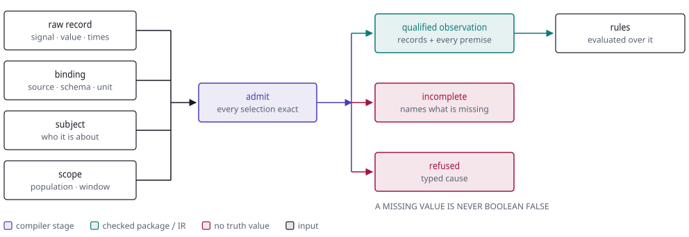
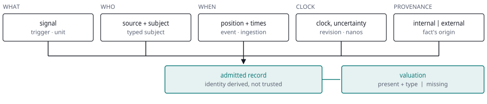

# filament-observation

[](https://discord.gg/k8DVhuYBR2)
[](https://github.com/agent-ix/filament-spec-language)

filament-observation is a Rust library that turns a raw signal from a running
system into a qualified observation. The result does not depend on how the signal was transported.

It checks the source, schema, subject, clock, window and population that the
caller selected for each signal. The result is `Available` for a fully qualified
set, `Incomplete` when a value, member or relationship is missing, or `Refused`
with a typed cause when a selection does not match. Rule evaluators such as
filament-mltl and filament-protocol use the `Available` observation as their data.

<picture>
  <source media="(prefers-color-scheme: dark)" srcset="docs/images/hero-dark.svg">
  
</picture>

> **Status: public prerelease.** The API is still changing and the crate is not
> published (`publish = false`). Expect breaking changes.

## Records

Each candidate record names everything it depends on, and admission compares each
name with the selection the caller made. Event time and ingestion time are kept
apart. Relationships must be supplied explicitly; a timestamp does not imply one.

<picture>
  <source media="(prefers-color-scheme: dark)" srcset="docs/images/record-dark.svg">
  
</picture>

## Usage

`admit` takes one `AdmissionRequest` (the package, producer bundle, binding,
expected subject, relationship candidates and any listed extent-completeness
states, scope, records and resource limits) and returns an `AdmissionOutcome`.
An omitted extent is unlisted; an explicitly incomplete extent remains
incomplete even when it contains a matching candidate. These tests from
[`tests/admission.rs`](tests/admission.rs) show the first two outcomes; the
`request()` helper in that file builds a complete, valid request.

```rust
// A valid record is admitted and every selected premise is retained.
let outcome = admit(request());
assert!(matches!(outcome, AdmissionOutcome::Available { observation }
    if observation.records()[0].visibility == Visibility::External
        && observation.package().identity == id("package:checkout")
        && observation.limits().max_records == 2));

// The same request with no value is incomplete, not false.
let mut input = request();
input.records[0].value = ValueState::Missing;
assert!(matches!(admit(input), AdmissionOutcome::Incomplete { reasons }
    if matches!(reasons.as_slice(), [IncompleteReason::MissingValuation { .. }])));
```

## Outcomes

Each outcome is one of three variants.

| Outcome | Meaning |
| --- | --- |
| `Available` | Every required premise was admitted. The `QualifiedObservation` keeps the package, producer, binding, subject, relationships, scope, records and limits exactly as selected. |
| `Incomplete` | A required premise is absent or its supplied extent is incomplete: `MissingValuation`, `MissingMembership`, `MissingRelationship`, `IncompleteRelationshipExtent` or `MissingClosure`. |
| `Refused` | A selection is invalid or does not match. `RefusalCause` says which: a binding, subject or clock mismatch, an invalid window, an exceeded limit, a duplicate record or member, an ambiguous or conflicting relationship, or an identity that differs from the one derived by the owner contract. |

## Owner contracts

The crate also publishes fourteen canonical, bounded owner
contracts for activation scope, observation records, populations, position
ledgers, clocks, partial facts, capture environments, progress, closure,
completeness, result availability, revisioned bundles and bounded lineage. Each
has a JSON Schema in [`schemas/`](schemas/) and a module under `authority::`
whose reader returns only a strict-read, validated view. The full table of
contract names and readers is in
[docs/owner-contracts.md](docs/owner-contracts.md).

## Limitations

The library has no telemetry adapter, temporal evaluator or protocol-result
mapper. It does not execute production monitors, interpret protocol conformance
or own an evidence store. The Producer interface 1.2 static bundle it admits
(`StaticProducerBundle`, `AdmittedStaticBundle` in `src/producer.rs`) is
validated by this crate's own code, and a test fixture of that shape lives in
[`tests/fixtures/`](tests/fixtures/).

## Filament ecosystem

<picture>
  <source media="(prefers-color-scheme: dark)" srcset="docs/images/ecosystem-dark.svg">
  
</picture>

filament-observation depends on
[quire-canonical](https://github.com/agent-ix/quire-canonical) for canonical JSON,
[filament-exact](https://github.com/agent-ix/filament-exact) for structural node identities,
and FSL foundation's node-wire codec for their canonical spelling.
[filament-mltl](https://github.com/agent-ix/filament-mltl) and [filament-protocol](https://github.com/agent-ix/filament-protocol) depend on this crate.


## Building and testing

The repository gate, from [AGENTS.md](AGENTS.md):

```sh
cargo fmt --check
cargo clippy --locked --all-targets -- -D warnings
cargo test --locked
RUSTDOCFLAGS="-D warnings" cargo doc --locked --no-deps
```

Hosted CI runs only when dispatched by hand, so run the gate locally before
opening a pull request. The requirements, test cases and reviews are Markdown
files under [`spec/`](spec/) and [`reviews/`](reviews/); tests are tagged with
the criteria they check.

## Contributing and license

Contributions need the [CLA](CLA.md); see [CONTRIBUTING.md](CONTRIBUTING.md) and
[AGENTS.md](AGENTS.md). Questions are welcome on
[Discord](https://discord.gg/k8DVhuYBR2). Licensed under
[AGPL-3.0-or-later](LICENSE).
